# CICFlowMeter-MG

CICFlowMeter 抓包、按流归并，然后为每条流输出一行 85 个特征。上游提供 Swing
界面和一个最简命令行入口。本分支保留这两者，另外做了三件事：加了一套带六个子命令的
CLI；给流量打上时间窗口标签；抓包过程中可以把结果实时发到 HTTP 接口。Docker、
Podman、systemd 这些部署件也放在本仓库里，不再散落到另一个项目。

[English](README.md) · **简体中文**

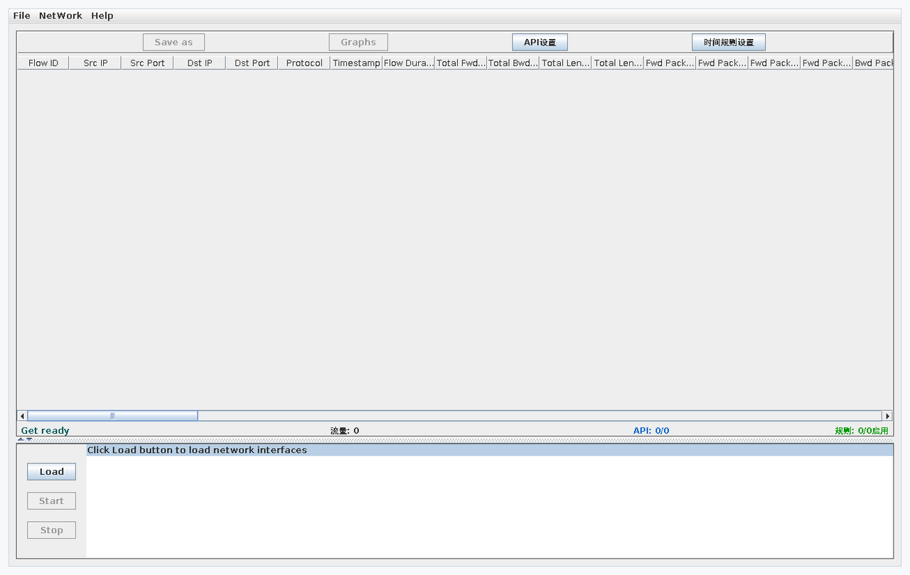
*启动后的界面。NetWork 菜单用来在实时抓包与离线分析之间切换。*

## 本分支改了什么

不是换个壳的重新打包，改动贯穿从抓包到输出的整条链路。右列标出改动所在文件，可以对着
提交记录核对。

| 方面 | 上游 4.0 | 本分支 |
|---|---|---|
| 入口 | Swing 界面、legacy `Cmd` | 界面、六个子命令的 CLI、legacy `Cmd` 补 `--help` / `--version`（`CLIMain.java`、`Cmd.java`） |
| 打标 | 无 | 时间规则标签：分组、规则、启用停用、JSON 导入导出（`TimeRuleManager.java`、`TimeLabelRule.java`、`RuleGroup.java`） |
| 数据出口 | 仅 CSV | CSV + 每条完成的流实时 POST 到 HTTP 接口（`ApiSendTask.java`、`ApiConfigManager.java`） |
| CSV 位置 | 固定 | 可配置输出目录，界面上也能改（`FlowMgr.setCustomSavePath`） |
| 可观测 | 无 | 健康检查接口 `/health` 与 `/config/status`（`HealthCheckServer.java`） |
| 运行状态 | 无 | 状态栏显示流数量、API 发送计数、启用规则数（`FlowMonitorPane.java`） |
| 配置方式 | 改文件 | 两个图形对话框（API 与 CSV、时间规则）+ `config` 子命令（`FlowMonitorPane.java`、`CLIMain.java`） |
| 日志 | log4j1 单一配置 | log4j2，界面与命令行分开配置，自定义 layouts（`log4j2.xml`、`log4j2-cli.xml`、`log4j2-layouts/`） |
| 文件处理 | 无 | 跨平台权限工具（POSIX 与 Windows，`FileSecurityUtils.java`） |
| 构建 | 单一发布包 | 三个 fatJar、启动脚本、原生库随包（`build.gradle`） |
| 打包 | 手工 | `packaging/package.sh` 生成 `jars/ lib/native/ bin/ config/` 与压缩包 |
| 部署 | 无 | 多阶段 Dockerfile、compose、systemd 单元、容器入口脚本 |

### 时间规则标签

规则存在配置目录的 `time_rules.json` 里，在流还在内存时打标，所以标签直接进 CSV
对应列，不需要事后关联。分组用来区分工作时段、非工作时段和一次性事件；停用某个分组
不会删掉它下面的规则。

```bash
cicflowmeter-cli config --import rules.json
cicflowmeter-cli config --groups
cicflowmeter-cli capture -i eth0 --time_label --health-check
```

### 实时特征上报

抓包时每条完成的流都可以 POST 到 HTTP 接口，下游检测服务不必轮询 CSV 文件。

```json
{
  "apiUrl": "http://127.0.0.1:5000/api/v1/process_stream",
  "apiEnabled": false,
  "csvEnabled": true,
  "csvSavePath": null
}
```

`csvSavePath: null` 表示用默认输出目录。`apiEnabled` 关掉后抓包路径完全不受影响，
不会发出任何请求。界面上的 `API设置` 与 `cicflowmeter-cli config --set` 都能改。

### 健康检查

```console
$ curl -s localhost:8888/health
{
  "status": "UP",
  "version": "4.1-enhanced",
  "service": "CICFlowMeter",
  "system": { "uptime": 4445, "memory": { "heapUsedMB": 25 } }
}
```

`/config/status` 返回解析后的配置目录以及 API、CSV 开关；根路径是一个小索引页，
链接到这两个端点。

### 命令行

| 子命令 | 用途 |
|---|---|
| `capture` | 在指定网卡上实时抓包，可同时开健康检查与特征上报 |
| `analyze` | 离线分析单个 pcap 或整个目录 |
| `config` | 查看与修改配置、导入导出时间规则、管理分组 |
| `status` | 规则数、分组数、API 配置、健康检查状态 |
| `daemon` | 启动与停止后台运行 |
| `health` | 单独启动、停止、探测健康检查接口 |

## 环境要求

- JDK 8（构建用 Gradle 4.2，跑不起来更新的 JDK）
- 运行期需要 libpcap；jnetpcap 的原生库链接的是 `libpcap.so`
- Linux 或 Windows；抓包需要 raw socket 权限

## 安装

### 用发布包

```bash
tar xzf cicflowmeter-4.1-enhanced-standalone-linux-x86_64.tar.gz -C /opt/cicflowmeter
/opt/cicflowmeter/bin/cicflowmeter-cli status
```

Windows 包结构相同，启动器换成 `.bat`，原生库换成 `.dll`。

### 用容器

```bash
docker run --rm --cap-add=NET_RAW --cap-add=NET_ADMIN \
  -p 8899:8888 -v "$PWD/data:/var/lib/cicflowmeter" \
  ghcr.io/DarkLord-W/cicflowmeter:4.1-enhanced \
  capture --interface eth0 --health-check
```

### 从源码构建

```bash
git clone https://github.com/DarkLord-W/cicflowmeter-mg.git
cd cicflowmeter-mg
export JAVA_HOME=/path/to/jdk8
./gradlew --no-daemon clean test fatJarCli fatJarGui fatJarLegacy
```

三个 jar 落在 `build/libs`。打包与排错见 [docs/BUILD.md](docs/BUILD.md)。

## 运行

### 图形界面

```bash
./bin/cicflowmeter-gui
```

抓包面板左侧是网卡列表（`Load`），`Start` / `Stop` 控制抓包，`Save as` 把流表
写成 CSV。图表在保存之后才可点：按 `Graphs` 打开刚写出的文件的图表面板。
`API设置` 与 `时间规则设置` 是两个配置对话框。

### 命令行

```bash
sudo ./bin/cicflowmeter-cli capture --interface eth0 --health-check
./bin/cicflowmeter-cli analyze /pcaps /out
./bin/cicflowmeter-cli capture --help
```

### 传统命令行

```bash
./bin/cicflowmeter-legacy /pcaps /out
./bin/cicflowmeter-legacy --version
```

## 界面截图

| 实时抓包面板 | 时间规则编辑 |
|---|---|
|  | 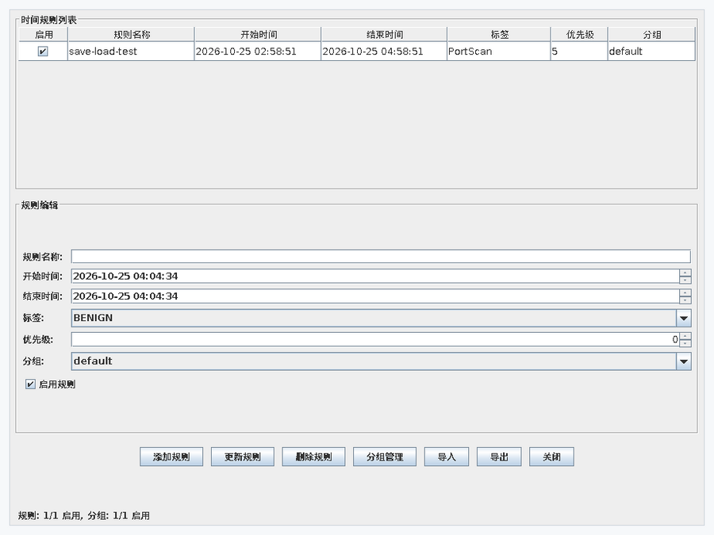 |
| 左侧网卡列表，中间流表，底部四项计数。 | 上方规则表，下方编辑器；分组可以整体停用，不必删规则。 |

| API 与 CSV 设置 | 离线分析 |
|---|---|
| 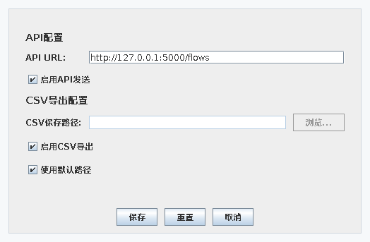 | 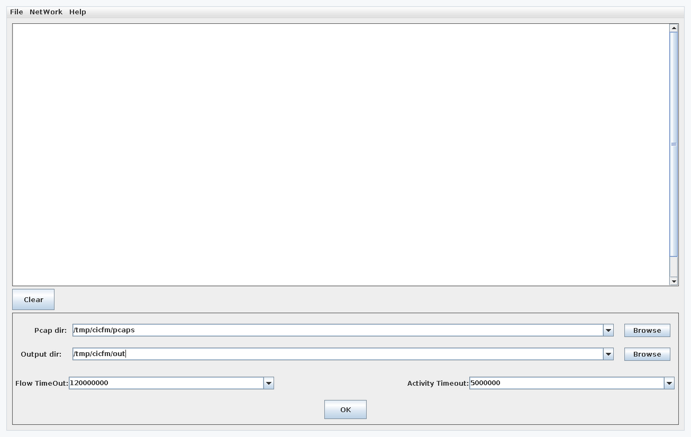 |
| 特征发往哪里、CSV 落在哪里。 | 指定 pcap 目录、两个超时参数，按 OK 开始。 |

| 分析结果 | 菜单 |
|---|---|
| 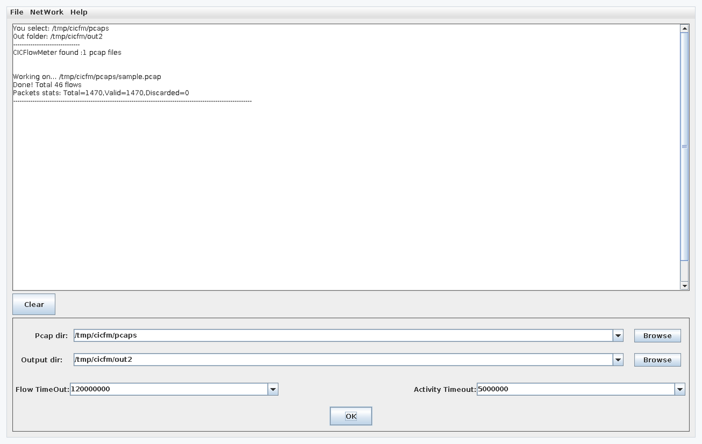 | 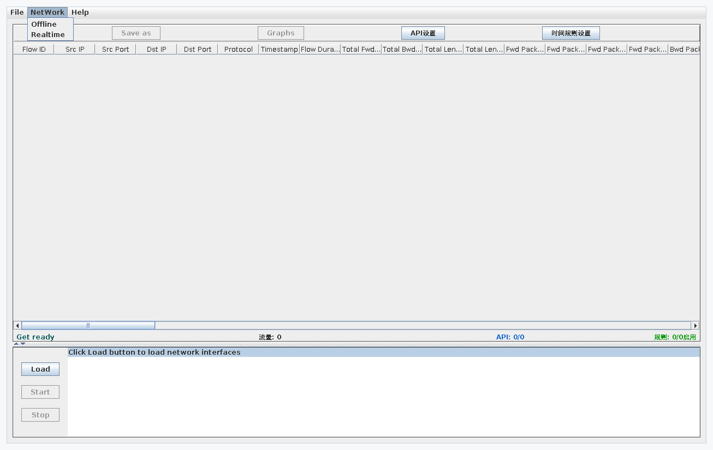 |
| 完成后的流量与报文统计。 | 两种工作模式就在一个菜单里。 |

| CLI 总览 | `capture` 选项 |
|---|---|
| 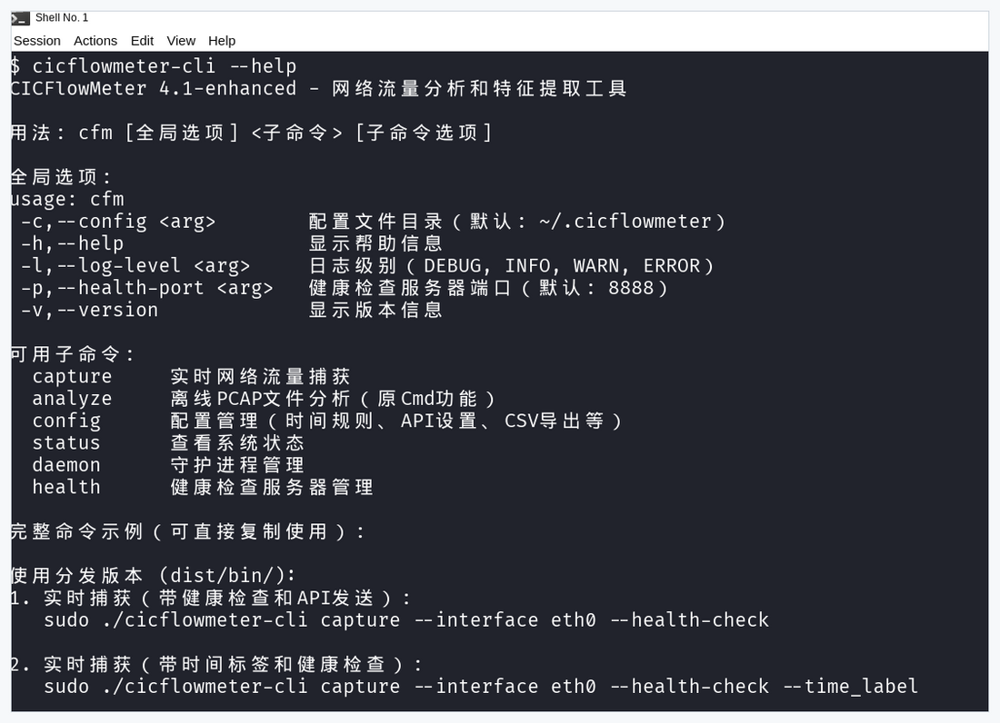 | 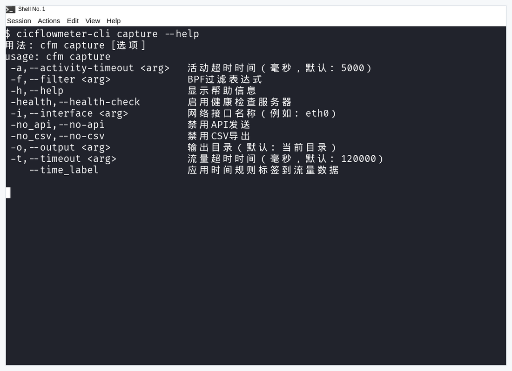 |
| 六个子命令，各自带帮助。 | 网卡、BPF 过滤、超时、健康检查、API/CSV 开关。 |

| 命令行离线分析 | 健康检查接口 |
|---|---|
| 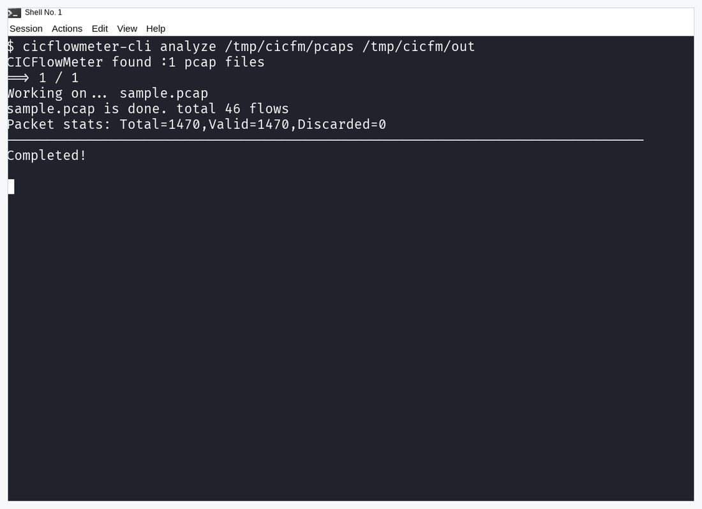 | 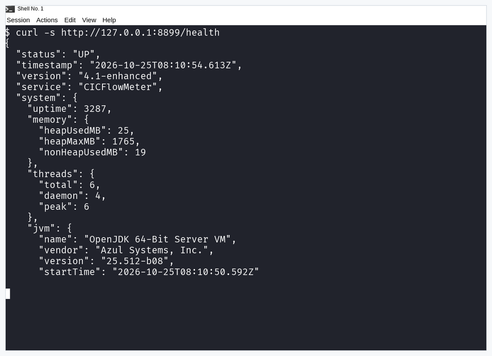 |
| 一个 pcap 进，一个 CSV 出，附报文统计。 | JSON 状态，含内存与线程计数。 |
| 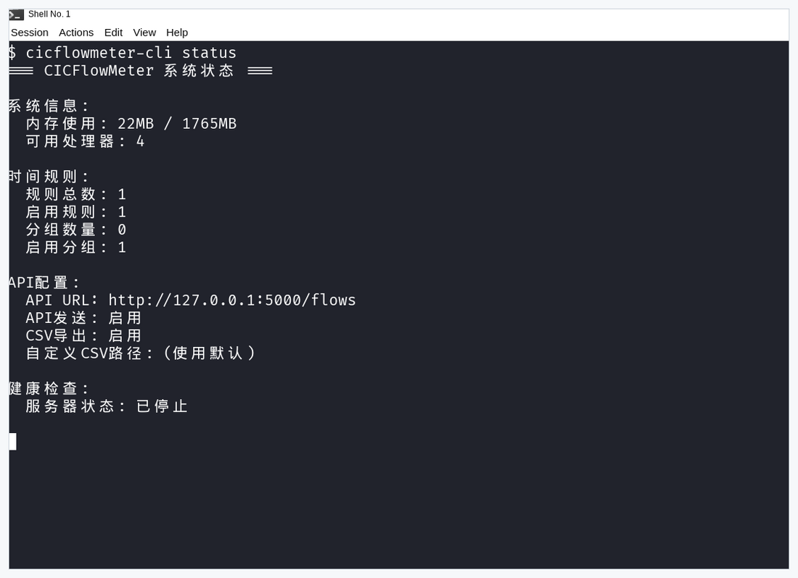 | 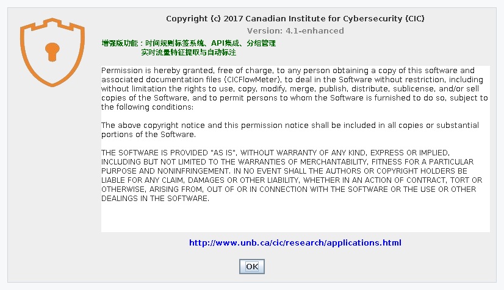 |
| 规则与分组计数、API 配置、健康检查状态。 | 上游版权、链接，以及本次构建的版本号。 |

## Docker 与 Podman

```bash
docker build -f container/Dockerfile -t cicflowmeter:4.1-enhanced .
docker compose -f container/docker-compose.yml up -d
curl -s localhost:8899/health
```

镜像在构建阶段编译三个 jar，运行阶段只带 jar、`libjnetpcap.so`、配置样例和
入口脚本。第一个参数决定用哪个 jar：`cli`（默认）、`gui` 或 `legacy`。
细节见 [container/README.md](container/README.md)。

抓包需要 `NET_RAW` 与 `NET_ADMIN`。缺了这两个能力，容器能起来，但 libpcap
打开网卡时会失败。

## systemd

```bash
sudo install -d /usr/share/cicflowmeter /var/lib/cicflowmeter /etc/cicflowmeter
sudo tar xzf cicflowmeter-4.1-enhanced-standalone-linux-x86_64.tar.gz -C /usr/share/cicflowmeter
sudo cp /usr/share/cicflowmeter/config/log4j2.xml /etc/cicflowmeter/
sudo cp packaging/systemd/cicflowmeter.service /etc/systemd/system/
sudo systemctl daemon-reload && sudo systemctl enable --now cicflowmeter
```

能力、资源限制、日志位置见 [docs/DEPLOY.md](docs/DEPLOY.md)。

## 配置

配置目录按下面顺序解析：

1. `-Dcicflowmeter.config.dir=...`
2. 环境变量 `CIC_CONFIG_DIR`
3. `~/.cicflowmeter`

里面有 `time_rules.json`（标签）和 `api_config.json`（上报地址）。健康检查端口
取自 `CIC_HEALTH_PORT` 或 `-Dcicflowmeter.health.port`，默认 8888。

## 常见问题

**报 `Failed to load library jnetpcap` 或 `dlopen` 失败** —— JVM 找不到原生库，
或者它依赖的 `libpcap.so` 不存在。用打包里的启动器（会设置 `java.library.path`），
并装上 libpcap 的开发包，让 `libpcap.so` 这个符号链接存在。

**报 `Unsupported class file major version`** —— Gradle 4.2 跑在比 8 新的 JDK 上。
把 `JAVA_HOME` 指到 JDK 8。

**抓包报权限错误** —— 给 JVM 原始套接字能力：

```bash
sudo setcap cap_net_raw,cap_net_admin=eip "$(readlink -f "$(which java)")"
```

**服务器上没有图形界面** —— 界面需要 X；用 `xvfb-run`，或者直接用命令行。

## 已知限制

- 命令行输出（含帮助与日志）目前是中文，英文界面是后续工作。
- 只带了 x86-64 的原生库；arm64 上抓包路径没有可用的 `libjnetpcap.so`。
- 图形界面需要 X，没有无头模式。
- 图表要从抓包面板保存 CSV 之后才能打开；源码里的 `Action → Visual` 菜单被注释掉了。
- 镜像在 CI 里构建；这里记录的源码构建与命令行行为只在 Linux x86-64 上实际跑过。

## 构建与测试

```bash
./gradlew test                              # TimeRuleManagerTest
./gradlew fatJarCli fatJarGui fatJarLegacy   # 三个可运行 jar
bash packaging/package.sh                   # Linux 包 + Windows 包 + 校验和
docker build -f container/Dockerfile .      # 镜像
```

## 目录

```
src/main/java/cic/cs/unb/ca/     抓包、流处理、标签、API、CLI、健康检查
src/main/resources/              log4j2 配置、配置样例、systemd 单元
src/test/java/                   规则管理器测试
container/                       Dockerfile、入口脚本、compose
packaging/                       打包脚本与 systemd 单元
examples/                        API 测试服务、辅助脚本
docs/                            构建、部署、分支说明、截图
```

## 上游、致谢与许可

这是**非官方分支**，不是 UNB 或加拿大网络安全研究所（CIC）的发布版本。

- 上游：<https://github.com/ahlashkari/CICFlowMeter>、
  <https://github.com/CanadianInstituteForCybersecurity/CICFlowMeter>
- 起点版本：CICFlowMeter 4.0；本分支以 `4.1-enhanced` 发布。
- 本仓库前 108 个提交来自上游，作者与提交信息原样保留。
- 上游采用 MIT 许可，本分支沿用同一许可（`LICENSE.txt` 末尾追加了本分支的版权行）。
- `MG` 沿用自本分支早期内部版本线（V1–V7）的命名，不是上游项目或组件的缩写。

CICFlowMeter（前身 ISCXFlowMeter）由加拿大新不伦瑞克大学（UNB）加拿大网络安全研究所
（CIC）开发。感谢原作者与核心贡献者：

- **Arash Habibi Lashkari** —— 研究者与开发者（创始人）
- **Gerard Drapper Gil** —— 研究者与开发者（联合创始人）
- **Muhammad Saiful Islam** —— 研究者与开发者（联合创始人）

也感谢 CIC 团队在 CICIDS2017 等数据集上的工作——本项目提取的 85 维特征体系即源于其规范。

如果在论文或研究中使用了本工具，请引用上游论文：

- Arash Habibi Lashkari, Gerard Draper-Gil, Mohammad Saiful Islam Mamun and
  Ali A. Ghorbani, "Characterization of Tor Traffic Using Time Based Features",
  ICISSP 2017, Porto, Portugal.
- Gerard Drapper Gil, Arash Habibi Lashkari, Mohammad Mamun, Ali A. Ghorbani,
  "Characterization of Encrypted and VPN Traffic Using Time-Related Features",
  ICISSP 2016, Rome, Italy, pp. 407–414.

问题与 PR 请提到本仓库，不要提到上游。抓包请只在获得授权的网络中进行。

## 版本

发布版本号是 `4.1-enhanced`，tag 是 `v4.1-enhanced`，后续补丁用 `.1`、`.2`
后缀。Release 流程会校验 tag 与 `build.gradle` 里的版本是否一致，不一致直接失败。
